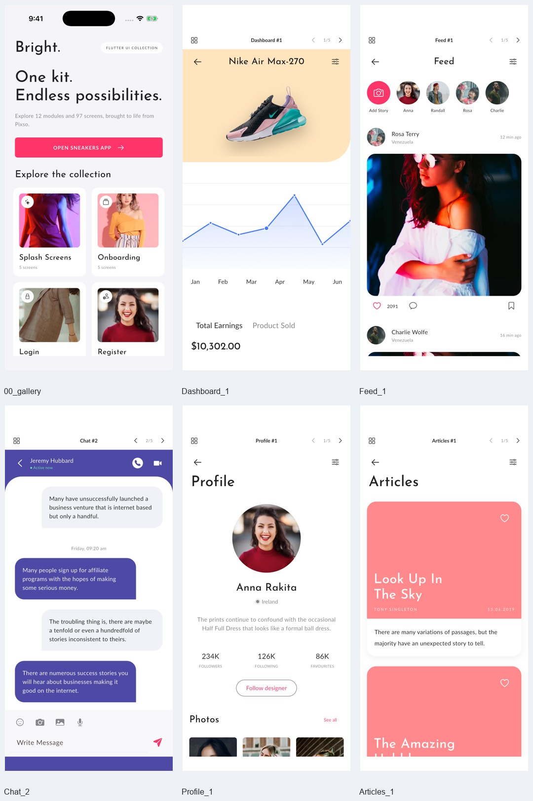
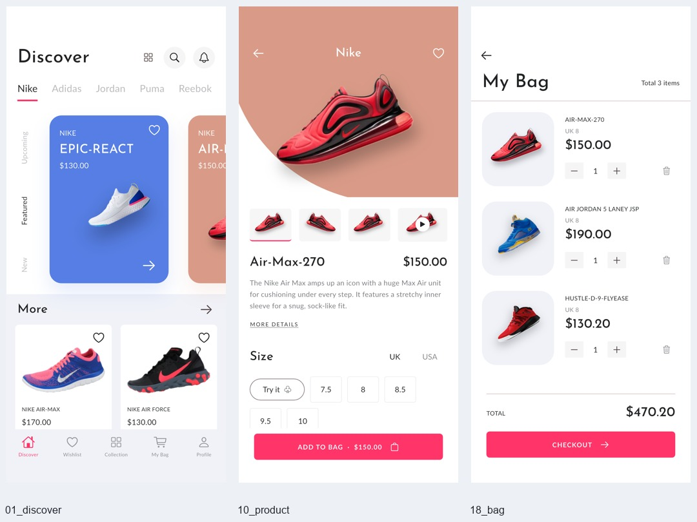
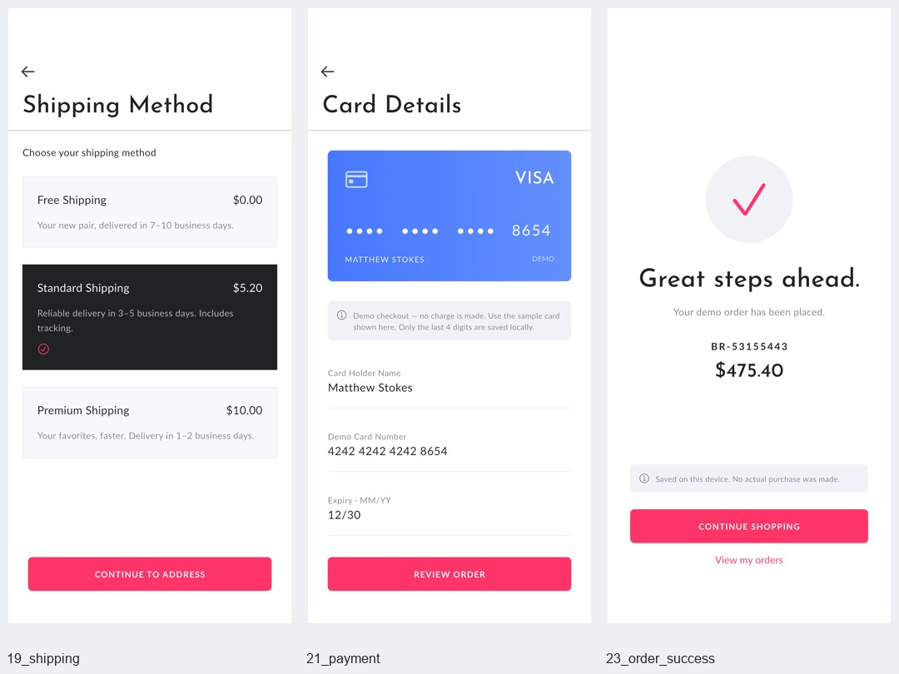
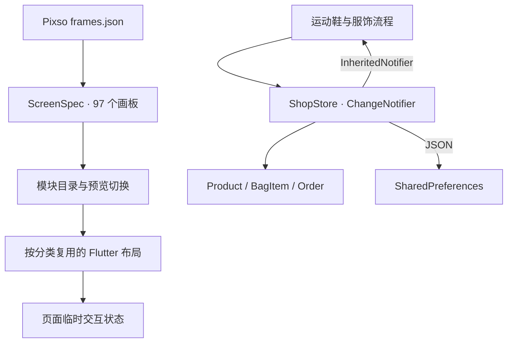

# Bright · Flutter 多模块 UI 展示 App

读取 Pixso「Bright Design File」实现的 Flutter 应用，覆盖 **12 个分类、97 个画板变体**。首页提供模块目录，每个模块可打开页面列表，预览顶部支持前后切换。运动鞋和服饰商品还可进入共享购物袋，完成本地演示结算。

## 主要界面

以下为 iPhone 17 Pro 模拟器中实际运行的 Flutter 界面。







[查看全部页面截图](docs/SCREENSHOTS.md) · [验证结果](docs/TESTING.md) · [Pixso 参考与映射](docs/design/REFERENCE.md)

## 模块范围

| 分类 | 画板数 | 实现内容 |
| --- | ---: | --- |
| Splash Screens | 5 | 摄影背景、渐变、纯黑、图形品牌标识、欢迎文案 |
| Onboarding | 5 | 全屏背景、上下分区、手机预览、卡片、注册 / 登录入口 |
| Login | 6 | 3 种登录布局及填写状态，密码显隐、表单校验 |
| Register | 10 | 下划线 / 边框表单、手机号、验证码、重置密码及对应状态 |
| E-commerce | 36 | 18 个运动鞋页面 + 18 个服饰页面，含浏览、详情、搜索、门店、收藏与购物袋 |
| Dashboard | 5 | 收入、销量、概览、时间维度、余额柱状图与交易 |
| Profile | 5 | 头像、封面、个人资料、作品集、深色布局与照片网格 |
| Menu | 5 | 浅色、粉色、深色、渐变和侧移布局，菜单可导航 |
| Feed | 5 | 圆形 / 卡片故事、照片动态、拼图、点赞、评论、收藏 |
| Chat | 5 | Chats / Calls / People、会话、草稿、表情、照片选择与本地发送 |
| Activity | 5 | 销售占比、滑动活动列表、热销商品、集合卡片、连接请求 |
| Articles | 5 | 编辑卡片、紧凑卡片、图片 / 纯色封面、圆角正文与收藏 |
| **合计** | **97** | 每个画板均有对应的 Flutter 页面入口 |

原稿里的键盘属于系统输入状态，使用真实文本输入与焦点交互；不把键盘截图嵌入页面。部分画板原本是纯色 / 空图片占位，保留为相应视觉布局。应用页面由 Flutter 控件绘制，未将完整设计稿截图用作页面。

## 可操作流程

- 模块目录 → 分类列表 → 页面预览 → 顶部前后切换。目录还提供独立运动鞋购物流程入口。
- 商品名称搜索、价格 / 品牌 / 颜色筛选、商品收藏、尺码与颜色选择。
- 购物袋数量修改、删除、规格合并 → 配送 → 地址 → 演示卡片 → 订单确认 → 下单成功 → 历史订单。
- 服饰详情加购与运动鞋共用购物袋、金额计算和订单记录。
- 测脚说明 → 演示扫描 → 示例结果 → 返回商品页回填尺码。
- 动态点赞、添加本地故事、评论和收藏；聊天发送文字、插入表情、选择示例照片。
- 切换统计周期、点击图表、关注设计师、删除活动、接受 / 拒绝连接、搜索 / 收藏文章。

**演示边界：** 认证不连接服务器；支付不扣款；不会创建真实物流或发送短信 / 重置邮件；相机、测脚、视频、通话与地图为界面演示，不调用对应服务。统计、活动和文章使用本地样例内容。相应入口有提示，商品目录包含 12 个运动鞋和 8 个服饰样例。

购物袋、订单、资料和运动鞋收藏保存至本机。动态、聊天、服饰收藏、关注及连接请求是页面内演示状态，重新进入页面时重置。

## 项目结构

```text
bright_app/
├── lib/
│   ├── main.dart                        # 初始化本地状态，启动应用
│   ├── app.dart                         # 全局主题与路由
│   ├── core/
│   │   ├── store.dart                   # 购物状态、计算与本地保存
│   │   └── theme.dart                   # 颜色、字体、控件主题
│   ├── data/
│   │   ├── models.dart                  # Product / BagItem / Order
│   │   ├── catalog.dart                 # 运动鞋与服饰商品数据
│   │   └── screen_catalog.dart          # 12 模块 / 97 画板注册表
│   ├── features/
│   │   ├── showcase/
│   │   │   ├── gallery.dart             # 模块目录、分类列表、切换容器
│   │   │   ├── preview.dart             # 画板分发及页面描述
│   │   │   ├── auth_previews.dart       # 启动、引导、账户布局变体
│   │   │   ├── fashion_pages.dart       # 服饰电商 18 个变体
│   │   │   ├── social_pages.dart        # 仪表盘、资料、菜单、动态
│   │   │   ├── community_pages.dart     # 聊天、活动、文章
│   │   │   └── demo_widgets.dart        # 图表、头像、图片等共用控件
│   │   ├── auth/auth_pages.dart         # 独立购物流程的账户页
│   │   ├── catalog/
│   │   │   ├── catalog_pages.dart       # 运动鞋导航、首页、列表、搜索筛选
│   │   │   └── product_page.dart        # 商品详情、尺码、媒体预览
│   │   ├── checkout/checkout_pages.dart # 购物袋与结算流程
│   │   └── account/account_pages.dart   # 订单、资料、通知、设置
│   └── shared/widgets.dart              # 状态注入与通用 UI
├── assets/images/                       # Pixso 图片，运行无需网络
├── assets/fonts/                        # Lato、Josefin Sans 与 OFL 授权
├── test/
│   ├── store_test.dart                  # 购物状态和恢复测试
│   └── showcase_test.dart               # 97 页面布局及注册表检查
├── integration_test/app_test.dart       # 模拟器交互、全量截图
├── test_driver/integration_test.dart     # 截图保存回调
├── tool/
│   ├── generate_screen_catalog.py       # 从 Pixso manifest 生成注册表
│   ├── prepare_assets.py                # 图片裁剪和尺寸限制
│   └── screenshot_gallery.py            # 文档配图、截图索引生成
├── docs/
│   ├── SCREENSHOTS.md                   # 全部截图索引
│   ├── TESTING.md                       # 测试结果与复现
│   ├── design/frames.json               # 读取到的原始画板清单
│   ├── design/REFERENCE.md              # 参考来源与实现说明
│   └── screenshots/                     # 模拟器实际截图
├── ios/
├── android/
└── web/
```

## 架构设计

按功能分层，展示层使用数据驱动的布局变体，购物业务使用集中状态。外部运行依赖只有 `cupertino_icons` 和 `shared_preferences`，未额外引入路由或状态框架。



- `ScreenSpec` 保存分类、原始节点 ID、名称、变体编号和模板类型，保证可追溯到原设计。
- `PreviewPage` 负责前后切换，以节点 ID 作为子树 Key，切换时释放旧页面控制器和临时状态。
- 同类布局通过参数复用，而非复制 97 份页面源码；图表、头像、图片、日期选择器及导航栏进一步复用。
- `ShopScope` 使用 `InheritedNotifier` 注入 `ShopStore`，购物状态变化后更新相关 UI。
- 金额采用整数美分，显示时格式化。购物袋键为 `productId / size / color`，数量 1–99，减至 0 删除。
- 下单复制商品条目建立快照并清空购物袋，后续购物不会改变历史订单。
- 本地键 `bright.state.v1`；保存资料、地址、收藏、购物袋、订单及卡片后四位，不保存密码、完整卡号或 CVV。
- 尺码演示结果通过导航返回，不添加全局临时尺码状态。

真实业务可通过 Repository / API 替换本地数据层；认证、支付、测脚、地图及聊天服务需单独接入。

## 运行

验证环境：Flutter **3.41.6** / Dart **3.11.4**，iPhone 17 Pro，iOS **26.0** 模拟器。

```bash
cd '/Users/liuyu/Desktop/Bright /bright_app'
flutter pub get
flutter run -d F13309E5-4B46-45C7-8C1E-036D1DC3DF07
```

也可使用 `flutter devices` 查询自己的设备 ID，或 `flutter run -d chrome` 本地预览 Web。

默认进入模块目录。购物演示使用任意有效格式邮箱与至少 6 位的临时密码；短信演示验证码 `5274`；卡片默认 `4242 4242 4242 8654`，有效期 `12/30`。

上级目录名末尾有空格，Xcode 会截断该路径，因此工程放在 `bright_app/` 子目录。不要直接移回带尾随空格的目录。

## 检查与截图

```bash
flutter analyze
flutter test
flutter drive --driver=test_driver/integration_test.dart \
  --target=integration_test/app_test.dart \
  -d F13309E5-4B46-45C7-8C1E-036D1DC3DF07
```

测试使用本地样例状态，覆盖购物闭环、代表性社区交互和全部画板入口。截图包括 97 个画板预览、12 个模块列表、模块目录和 31 个购物流程页面 / 状态。

重新生成文档拼图与索引：

```bash
python3 -m venv /tmp/bright-image-tools
/tmp/bright-image-tools/bin/pip install Pillow
/tmp/bright-image-tools/bin/python tool/screenshot_gallery.py
```

## 代码精简与素材

移除了默认计数器、数值命名包装层、重复状态栏 / Home Indicator、生成式尺寸适配辅助文件及未使用素材。97 个变体通过分类模板和注册表复用，图片去除透明留白并限制尺寸，不保留无法运行的生成代码作为生产源码。

设计图片来自用户提供的 Pixso 文件，品牌标识与名称归各权利人所有。字体 OFL 授权文件位于 `assets/fonts/`。
