# 界面截图索引

截图来自 iPhone 17 Pro / iOS 26.0 模拟器中的实际 Flutter 页面。画板预览顶部的目录及前后切换条属于展示 App 的导航。

97 个画板预览 + 12 个模块列表 + 1 个模块目录 + 31 个购物流程页面 / 状态，共 141 张 PNG。

## 模块目录

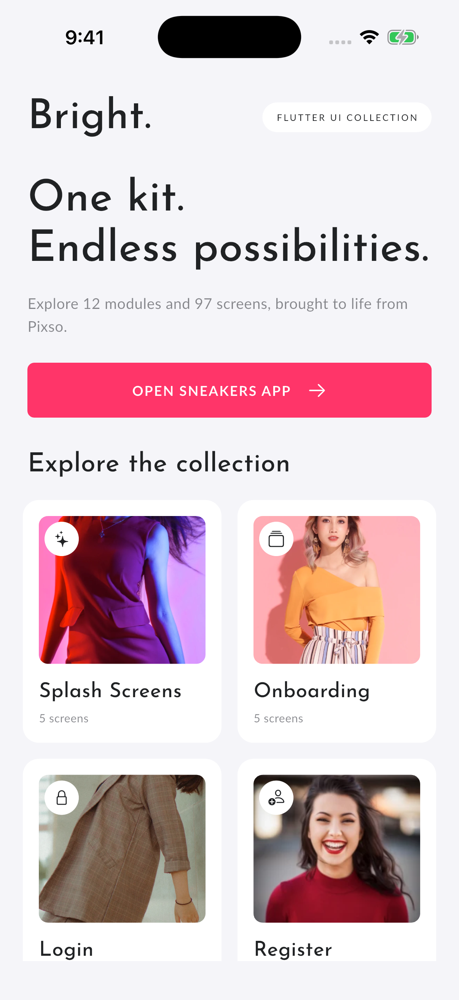

## 全部 97 个画板

### 1. Splash Screens

[模块列表截图](screenshots/module_01.png)

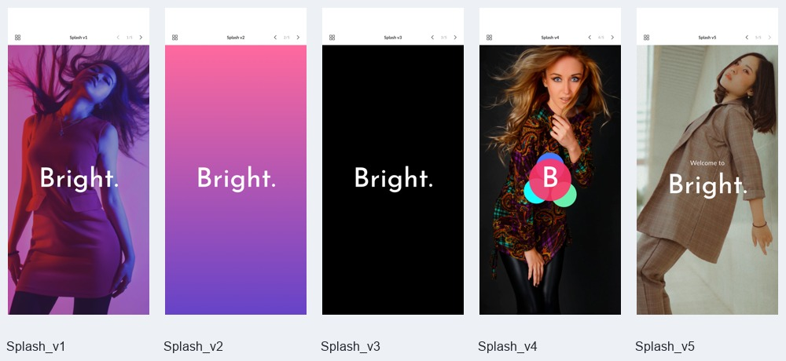

| 序号 | Pixso 画板 | 节点 ID | 实际界面 |
| --- | --- | --- | --- |
| 001 | Splash v1 | `0:44` | [截图](screenshots/ui_001_Splash_v1.png) |
| 002 | Splash v2 | `0:33` | [截图](screenshots/ui_002_Splash_v2.png) |
| 003 | Splash v3 | `0:26` | [截图](screenshots/ui_003_Splash_v3.png) |
| 004 | Splash v4 | `0:14` | [截图](screenshots/ui_004_Splash_v4.png) |
| 005 | Splash v5 | `0:2` | [截图](screenshots/ui_005_Splash_v5.png) |

### 2. Onboarding Screen

[模块列表截图](screenshots/module_02.png)

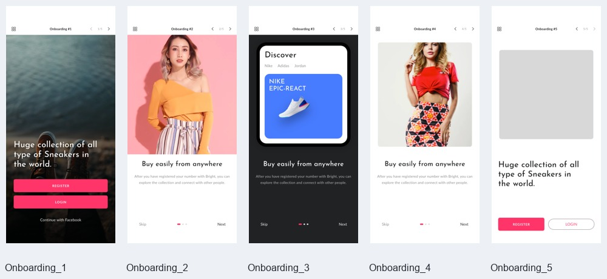

| 序号 | Pixso 画板 | 节点 ID | 实际界面 |
| --- | --- | --- | --- |
| 006 | Onboarding #1 | `0:192` | [截图](screenshots/ui_006_Onboarding_1.png) |
| 007 | Onboarding #2 | `0:175` | [截图](screenshots/ui_007_Onboarding_2.png) |
| 008 | Onboarding #3 | `0:110` | [截图](screenshots/ui_008_Onboarding_3.png) |
| 009 | Onboarding #4 | `0:85` | [截图](screenshots/ui_009_Onboarding_4.png) |
| 010 | Onboarding #5 | `0:51` | [截图](screenshots/ui_010_Onboarding_5.png) |

### 3. Login

[模块列表截图](screenshots/module_03.png)

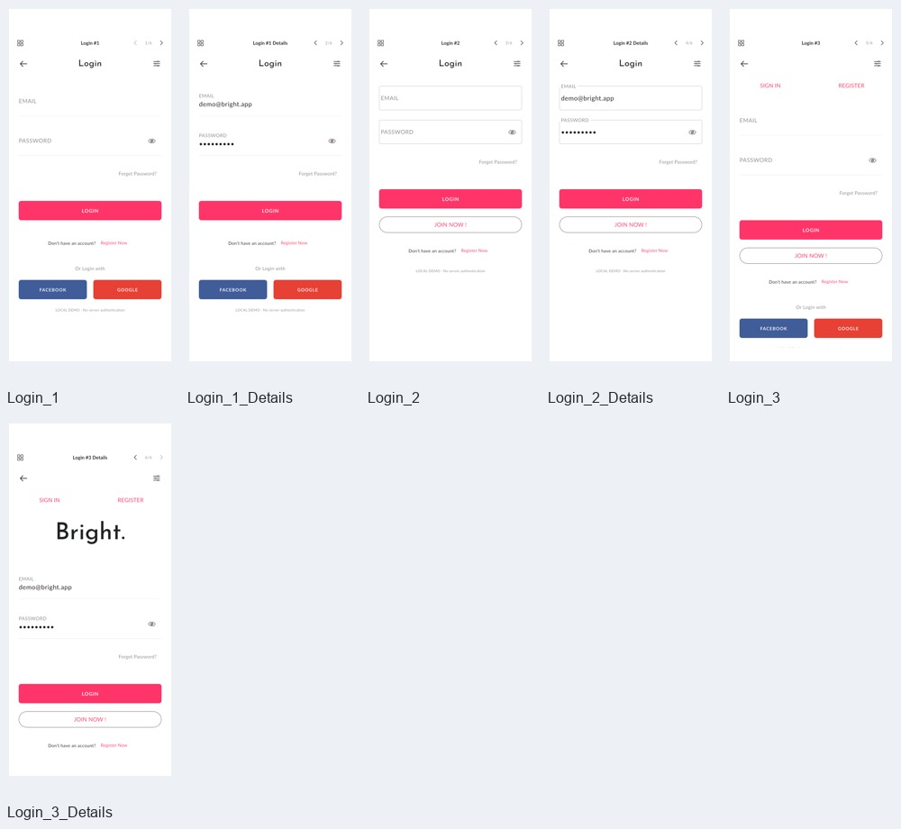

| 序号 | Pixso 画板 | 节点 ID | 实际界面 |
| --- | --- | --- | --- |
| 011 | Login #1 | `0:375` | [截图](screenshots/ui_011_Login_1.png) |
| 012 | Login #1 Details | `0:335` | [截图](screenshots/ui_012_Login_1_Details.png) |
| 013 | Login #2 | `0:318` | [截图](screenshots/ui_013_Login_2.png) |
| 014 | Login #2 Details | `0:298` | [截图](screenshots/ui_014_Login_2_Details.png) |
| 015 | Login #3 | `0:260` | [截图](screenshots/ui_015_Login_3.png) |
| 016 | Login #3 Details | `0:217` | [截图](screenshots/ui_016_Login_3_Details.png) |

### 4. Register

[模块列表截图](screenshots/module_04.png)

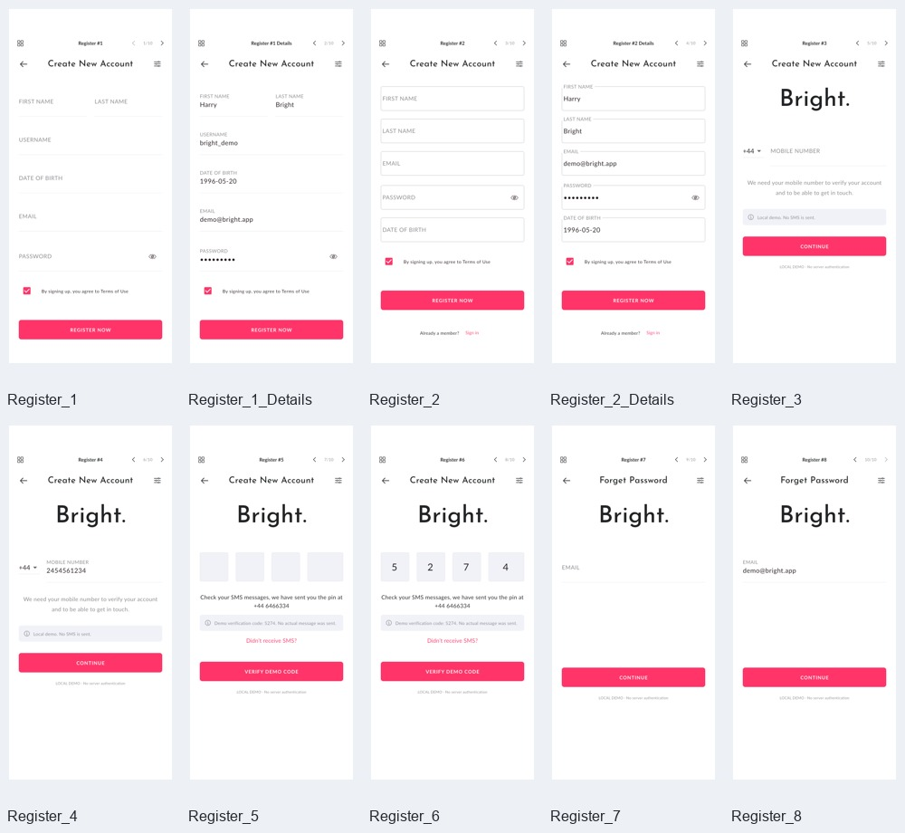

| 序号 | Pixso 画板 | 节点 ID | 实际界面 |
| --- | --- | --- | --- |
| 017 | Register #1 | `0:801` | [截图](screenshots/ui_017_Register_1.png) |
| 018 | Register #1 Details | `0:749` | [截图](screenshots/ui_018_Register_1_Details.png) |
| 019 | Register #2 | `0:721` | [截图](screenshots/ui_019_Register_2.png) |
| 020 | Register #2 Details | `0:693` | [截图](screenshots/ui_020_Register_2_Details.png) |
| 021 | Register #3 | `0:611` | [截图](screenshots/ui_021_Register_3.png) |
| 022 | Register #4 | `0:528` | [截图](screenshots/ui_022_Register_4.png) |
| 023 | Register #5 | `0:514` | [截图](screenshots/ui_023_Register_5.png) |
| 024 | Register #6 | `0:431` | [截图](screenshots/ui_024_Register_6.png) |
| 025 | Register #7 | `0:422` | [截图](screenshots/ui_025_Register_7.png) |
| 026 | Register #8 | `0:412` | [截图](screenshots/ui_026_Register_8.png) |

### 5. E-commerce

[模块列表截图](screenshots/module_05.png)

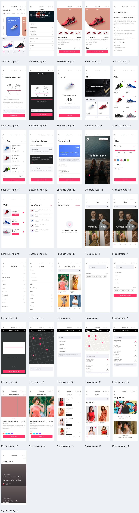

| 序号 | Pixso 画板 | 节点 ID | 实际界面 |
| --- | --- | --- | --- |
| 027 | Sneakers App #1 | `0:3807` | [截图](screenshots/ui_027_Sneakers_App_1.png) |
| 028 | Sneakers App #2 | `0:3720` | [截图](screenshots/ui_028_Sneakers_App_2.png) |
| 029 | Sneakers App #3 | `0:3589` | [截图](screenshots/ui_029_Sneakers_App_3.png) |
| 030 | Sneakers App #4 | `0:3473` | [截图](screenshots/ui_030_Sneakers_App_4.png) |
| 031 | Sneakers App #5 | `0:3361` | [截图](screenshots/ui_031_Sneakers_App_5.png) |
| 032 | Sneakers App #6 | `0:3212` | [截图](screenshots/ui_032_Sneakers_App_6.png) |
| 033 | Sneakers App #7 | `0:3110` | [截图](screenshots/ui_033_Sneakers_App_7.png) |
| 034 | Sneakers App #8 | `0:2910` | [截图](screenshots/ui_034_Sneakers_App_8.png) |
| 035 | Sneakers App #9 | `0:2814` | [截图](screenshots/ui_035_Sneakers_App_9.png) |
| 036 | Sneakers App #10 | `0:2748` | [截图](screenshots/ui_036_Sneakers_App_10.png) |
| 037 | Sneakers App #11 | `0:2686` | [截图](screenshots/ui_037_Sneakers_App_11.png) |
| 038 | Sneakers App #12 | `0:2657` | [截图](screenshots/ui_038_Sneakers_App_12.png) |
| 039 | Sneakers App #13 | `0:2405` | [截图](screenshots/ui_039_Sneakers_App_13.png) |
| 040 | Sneakers App #14 | `0:2355` | [截图](screenshots/ui_040_Sneakers_App_14.png) |
| 041 | Sneakers App #15 | `0:2304` | [截图](screenshots/ui_041_Sneakers_App_15.png) |
| 042 | Sneakers App #16 | `0:2247` | [截图](screenshots/ui_042_Sneakers_App_16.png) |
| 043 | Sneakers App #17 | `0:2155` | [截图](screenshots/ui_043_Sneakers_App_17.png) |
| 044 | Sneakers App #18 | `0:2128` | [截图](screenshots/ui_044_Sneakers_App_18.png) |
| 045 | E-commerce #1 | `0:2092` | [截图](screenshots/ui_045_E_commerce_1.png) |
| 046 | E-commerce #2 | `0:2019` | [截图](screenshots/ui_046_E_commerce_2.png) |
| 047 | E-commerce #3 | `0:1965` | [截图](screenshots/ui_047_E_commerce_3.png) |
| 048 | E-commerce #4 | `0:1911` | [截图](screenshots/ui_048_E_commerce_4.png) |
| 049 | E-commerce #5 | `0:1835` | [截图](screenshots/ui_049_E_commerce_5.png) |
| 050 | E-commerce #6 | `0:1695` | [截图](screenshots/ui_050_E_commerce_6.png) |
| 051 | E-commerce #7 | `0:1542` | [截图](screenshots/ui_051_E_commerce_7.png) |
| 052 | E-commerce #8 | `0:1524` | [截图](screenshots/ui_052_E_commerce_8.png) |
| 053 | E-commerce #9 | `0:1514` | [截图](screenshots/ui_053_E_commerce_9.png) |
| 054 | E-commerce #10 | `0:1364` | [截图](screenshots/ui_054_E_commerce_10.png) |
| 055 | E-commerce #11 | `0:1293` | [截图](screenshots/ui_055_E_commerce_11.png) |
| 056 | E-commerce #12 | `0:1228` | [截图](screenshots/ui_056_E_commerce_12.png) |
| 057 | E-commerce #13 | `0:1179` | [截图](screenshots/ui_057_E_commerce_13.png) |
| 058 | E-commerce #14 | `0:1130` | [截图](screenshots/ui_058_E_commerce_14.png) |
| 059 | E-commerce #15 | `0:1015` | [截图](screenshots/ui_059_E_commerce_15.png) |
| 060 | E-commerce #16 | `0:923` | [截图](screenshots/ui_060_E_commerce_16.png) |
| 061 | E-commerce #17 | `0:890` | [截图](screenshots/ui_061_E_commerce_17.png) |
| 062 | E-commerce #18 | `0:844` | [截图](screenshots/ui_062_E_commerce_18.png) |

### 6. Dashboard

[模块列表截图](screenshots/module_06.png)

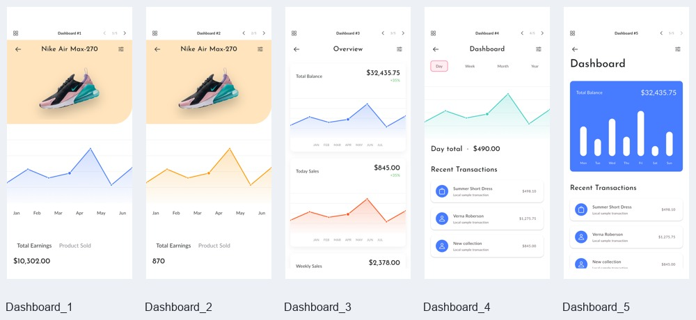

| 序号 | Pixso 画板 | 节点 ID | 实际界面 |
| --- | --- | --- | --- |
| 063 | Dashboard #1 | `0:4224` | [截图](screenshots/ui_063_Dashboard_1.png) |
| 064 | Dashboard #2 | `0:4170` | [截图](screenshots/ui_064_Dashboard_2.png) |
| 065 | Dashboard #3 | `0:4085` | [截图](screenshots/ui_065_Dashboard_3.png) |
| 066 | Dashboard #4 | `0:4033` | [截图](screenshots/ui_066_Dashboard_4.png) |
| 067 | Dashboard #5 | `0:3932` | [截图](screenshots/ui_067_Dashboard_5.png) |

### 7. Profile

[模块列表截图](screenshots/module_07.png)

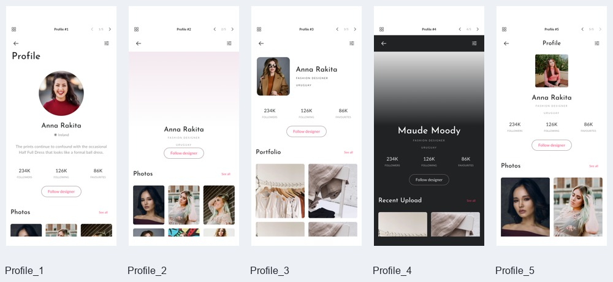

| 序号 | Pixso 画板 | 节点 ID | 实际界面 |
| --- | --- | --- | --- |
| 068 | Profile #1 | `0:4443` | [截图](screenshots/ui_068_Profile_1.png) |
| 069 | Profile #2 | `0:4395` | [截图](screenshots/ui_069_Profile_2.png) |
| 070 | Profile #3 | `0:4349` | [截图](screenshots/ui_070_Profile_3.png) |
| 071 | Profile #4 | `0:4313` | [截图](screenshots/ui_071_Profile_4.png) |
| 072 | Profile #5 | `0:4280` | [截图](screenshots/ui_072_Profile_5.png) |

### 8. Menu

[模块列表截图](screenshots/module_08.png)

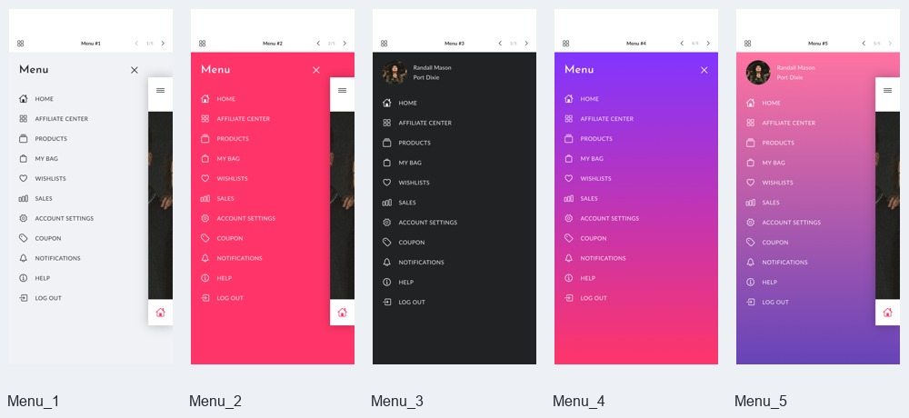

| 序号 | Pixso 画板 | 节点 ID | 实际界面 |
| --- | --- | --- | --- |
| 073 | Menu #1 | `0:4891` | [截图](screenshots/ui_073_Menu_1.png) |
| 074 | Menu #2 | `0:4801` | [截图](screenshots/ui_074_Menu_2.png) |
| 075 | Menu #3 | `0:4699` | [截图](screenshots/ui_075_Menu_3.png) |
| 076 | Menu #4 | `0:4605` | [截图](screenshots/ui_076_Menu_4.png) |
| 077 | Menu #5 | `0:4500` | [截图](screenshots/ui_077_Menu_5.png) |

### 9. Feed

[模块列表截图](screenshots/module_09.png)

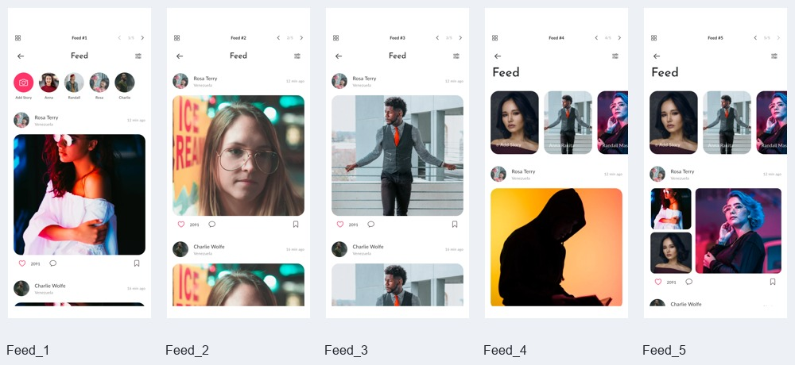

| 序号 | Pixso 画板 | 节点 ID | 实际界面 |
| --- | --- | --- | --- |
| 078 | Feed #1 | `0:5207` | [截图](screenshots/ui_078_Feed_1.png) |
| 079 | Feed #2 | `0:5169` | [截图](screenshots/ui_079_Feed_2.png) |
| 080 | Feed #3 | `0:5131` | [截图](screenshots/ui_080_Feed_3.png) |
| 081 | Feed #4 | `0:5067` | [截图](screenshots/ui_081_Feed_4.png) |
| 082 | Feed #5 | `0:4982` | [截图](screenshots/ui_082_Feed_5.png) |

### 10. Chat

[模块列表截图](screenshots/module_10.png)

| 序号 | Pixso 画板 | 节点 ID | 实际界面 |
| --- | --- | --- | --- |
| 083 | Chat #1 | `0:5835` | [截图](screenshots/ui_083_Chat_1.png) |
| 084 | Chat #2 | `0:5732` | [截图](screenshots/ui_084_Chat_2.png) |
| 085 | Chat #3 | `0:5510` | [截图](screenshots/ui_085_Chat_3.png) |
| 086 | Chat #4 | `0:5380` | [截图](screenshots/ui_086_Chat_4.png) |
| 087 | Chat #5 | `0:5261` | [截图](screenshots/ui_087_Chat_5.png) |

### 11. Activity

[模块列表截图](screenshots/module_11.png)

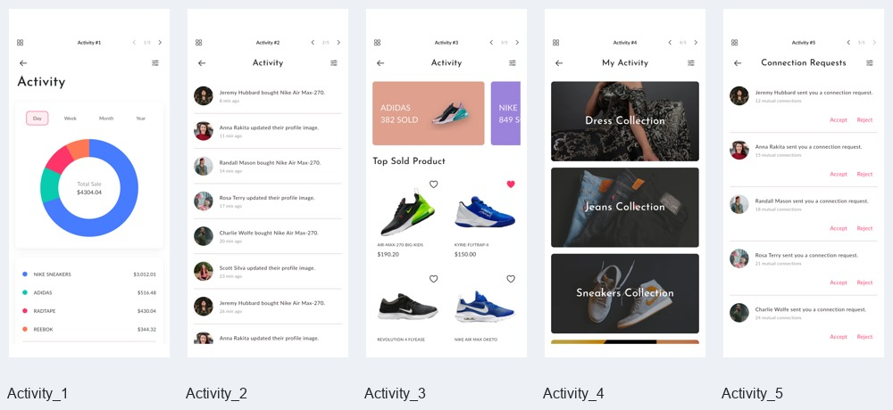

| 序号 | Pixso 画板 | 节点 ID | 实际界面 |
| --- | --- | --- | --- |
| 088 | Activity #1 | `0:6188` | [截图](screenshots/ui_088_Activity_1.png) |
| 089 | Activity #2 | `0:6090` | [截图](screenshots/ui_089_Activity_2.png) |
| 090 | Activity #3 | `0:6028` | [截图](screenshots/ui_090_Activity_3.png) |
| 091 | Activity #4 | `0:5985` | [截图](screenshots/ui_091_Activity_4.png) |
| 092 | Activity #5 | `0:5889` | [截图](screenshots/ui_092_Activity_5.png) |

### 12. Articles

[模块列表截图](screenshots/module_12.png)

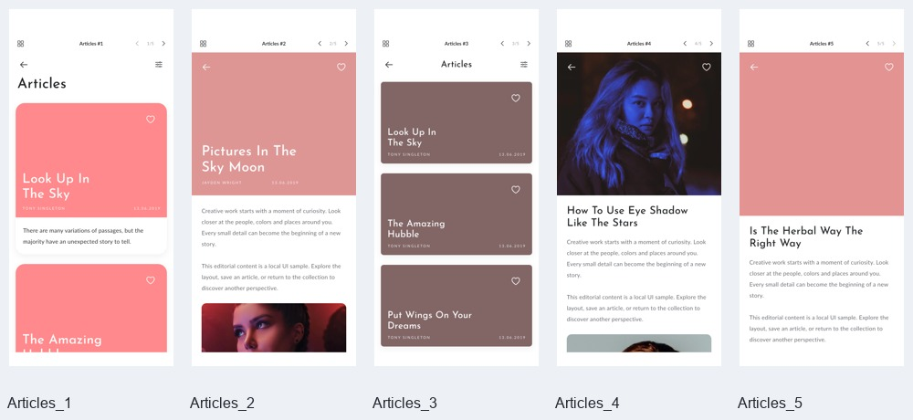

| 序号 | Pixso 画板 | 节点 ID | 实际界面 |
| --- | --- | --- | --- |
| 093 | Articles #1 | `0:6433` | [截图](screenshots/ui_093_Articles_1.png) |
| 094 | Articles #2 | `0:6405` | [截图](screenshots/ui_094_Articles_2.png) |
| 095 | Articles #3 | `0:6344` | [截图](screenshots/ui_095_Articles_3.png) |
| 096 | Articles #4 | `0:6319` | [截图](screenshots/ui_096_Articles_4.png) |
| 097 | Articles #5 | `0:6294` | [截图](screenshots/ui_097_Articles_5.png) |

## 独立购物流程及补充状态

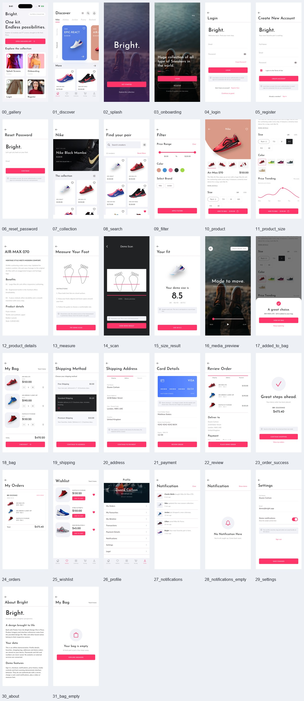

| 文件 | 界面 / 状态 |
| --- | --- |
| [01_discover.png](screenshots/01_discover.png) | 运动鞋首页 |
| [02_splash.png](screenshots/02_splash.png) | 启动页 |
| [03_onboarding.png](screenshots/03_onboarding.png) | 引导页 |
| [04_login.png](screenshots/04_login.png) | 登录 |
| [05_register.png](screenshots/05_register.png) | 注册 |
| [06_reset_password.png](screenshots/06_reset_password.png) | 重置密码 |
| [07_collection.png](screenshots/07_collection.png) | 商品集合 |
| [08_search.png](screenshots/08_search.png) | 搜索 |
| [09_filter.png](screenshots/09_filter.png) | 筛选 |
| [10_product.png](screenshots/10_product.png) | 商品详情 |
| [11_product_size.png](screenshots/11_product_size.png) | 尺码选择 |
| [12_product_details.png](screenshots/12_product_details.png) | 商品说明 |
| [13_measure.png](screenshots/13_measure.png) | 测脚说明 |
| [14_scan.png](screenshots/14_scan.png) | 演示扫描 |
| [15_size_result.png](screenshots/15_size_result.png) | 示例尺码结果 |
| [16_media_preview.png](screenshots/16_media_preview.png) | 媒体预览 |
| [17_added_to_bag.png](screenshots/17_added_to_bag.png) | 加入购物袋确认 |
| [18_bag.png](screenshots/18_bag.png) | 购物袋 |
| [19_shipping.png](screenshots/19_shipping.png) | 配送方式 |
| [20_address.png](screenshots/20_address.png) | 地址 |
| [21_payment.png](screenshots/21_payment.png) | 演示卡片 |
| [22_review.png](screenshots/22_review.png) | 订单确认 |
| [23_order_success.png](screenshots/23_order_success.png) | 下单成功 |
| [24_orders.png](screenshots/24_orders.png) | 历史订单 |
| [25_wishlist.png](screenshots/25_wishlist.png) | 收藏 |
| [26_profile.png](screenshots/26_profile.png) | 个人中心 |
| [27_notifications.png](screenshots/27_notifications.png) | 通知列表 |
| [28_notifications_empty.png](screenshots/28_notifications_empty.png) | 空通知 |
| [29_settings.png](screenshots/29_settings.png) | 设置 |
| [30_about.png](screenshots/30_about.png) | 应用说明 |
| [31_bag_empty.png](screenshots/31_bag_empty.png) | 空购物袋 |
